# Plan & Code


Visual planning tools for handing design intent to AI coding agents — zero dependencies, zero build, plain HTML files.

You browse your real site, drag gold "planned" boxes where things *should* go, scribble notes and motion paths, then hit one button: **Copy AI HANDOFF spec**. The result is a self-contained text spec (existing vs planned geometry, notes, animation specs, raw JSON) that any AI coding agent can read and apply to your codebase. Plan visually, let the AI write the code.

## The tools

| File | What it does |
|---|---|
| `index.html` | **Studio home.** Landing page with the box art, a launcher for each tool, a sample of the AI handoff, and the Sovereign Software shelf. |
| `blueprint.html` | **2D site blueprint.** Loads any same-origin page in an iframe and overlays a drafting layer on top: track elements, drag planned layouts, attach notes, spec animations with hand-drawn motion paths, freehand sketch. Exports an AI handoff spec. |
| `plan.html` | **Top-down floor-plan editor** for 3D scenes. Drag objects and the camera on an architect-style plan; it emits the exact `models/layout.js` your three.js (or other) scene imports. |
| `demo/index.html` | Sample target page ("Aurora Coffee") so blueprint.html works out of the box. |
| `demo/shelf.html` | Second sample target page: the Software Shelf, built from the shelf box art, with two views (`<body data-view="shelf|terminal">`) to show per-view plans and drawings. |
| `models/layout.js` | Sample floor-plan data (an observatory study room) read by plan.html. |
| `docs/BLUEPRINT-README.md` | The AI handoff spec — the contract an AI agent reads before applying an exported blueprint. |
| `tests/smoke.cjs` | Optional Playwright smoke test for all pages (the tools themselves need no dependencies). |

## Features

### blueprint.html
- **Blueprint view** — the live site desaturates to blueprint blue under a 2%/10% drafting grid; toggle it off to see true colors.
- **Five modes** — Browse (site stays fully interactive), Plan (drag layouts), Notes, Animate, Draw.
- **Element tracking** — hover the live page, click to track. Selectors are auto-generated (id → known label → unique class combo → nth-child path) and renamable.
- **Existing vs planned** — cyan solid box = where the element is now; gold dashed box = where you want it. Drag to move (0.5% snap), grab the corner grip to resize, or type exact percentages.
- **Live preview** — "apply plan to live" pushes the planned rect onto the real element inside the iframe (respecting its positioning scheme); "revert live" undoes it.
- **Notes** — one instruction per line, attached to any tracked element.
- **Animation specs** — name, trigger (click/hover/power-on/power-off/always/scroll/drag), duration, easing (including `friction` momentum decay), prose description, and a **hand-drawn motion path** captured in viewport %. Preview any spec in-place via the Web Animations API.
- **Freehand drawing** — pen, arrow, erase; stored per view (`<body data-view="...">` on the target page).
- **Exports** — AI HANDOFF spec (clipboard), JSON download, planned-rect CSS.
- **Load** — re-import a downloaded blueprint JSON (to share plans between machines or people).
- **Page picker** — switch between the bundled demo pages (or any `?page=`) from the panel.
- **Keyboard** — `1`–`5` switch modes, arrow keys nudge the selected planned box 0.5% (`Shift` = 5%), `Esc` deselects or cancels a motion-path capture.
- **Persistence** — everything autosaves to localStorage, keyed per target page.
- **Any page** — `blueprint.html?page=your-page.html` (must be same-origin).

### plan.html
- Architect-style top-down view: walls, grid, compass, footprint rectangles with heading arrows.
- Drag objects with 5-unit snap; rotate, set height, pick mount plane (floor / table top / ceiling), flag spin and hero objects — all color-coded.
- Drag the gold camera dot to reposition where the viewer ends up (with view cone).
- The output panel always shows the **exact `layout.js` code** (both `ROOM` and `ITEMS`) for the current arrangement — copy or download it, drop it over `models/layout.js`, done. Also exposed on the console as `window.layoutCode()`.
- **Keyboard** — arrow keys nudge the selection 5 units (`Shift` = 25), `R` rotates 15° (`Shift+R` back), `Esc` deselects. **↺ reset** reloads the file.

## Quick Start

No install, no build. Just serve the folder (a server is required — the iframe and ES-module import don't work over `file://`):

```bash
git clone https://github.com/Frog-dex/plan-and-code.git
cd plan-and-code
python3 -m http.server 8080
```

Then open:

- http://localhost:8080/ — the studio home (launcher for everything below)
- http://localhost:8080/blueprint.html — blueprint the demo page
- http://localhost:8080/blueprint.html?page=./demo/shelf.html — blueprint the two-view shelf demo
- http://localhost:8080/plan.html — the floor-plan editor

Try it in 60 seconds:

1. In blueprint.html, click **✥ Plan**, then click the hero on the demo page.
2. Drag the gold dashed box somewhere new (or nudge it with the arrow keys); add a note in **✎ Notes**.
3. Click **◉ Animate**, hit **✏ draw motion path**, scribble an arc on the stage, then **+ add animation** and **▶ preview**.
4. Click **⧉ Copy AI HANDOFF spec** — paste that into your AI coding agent along with `docs/BLUEPRINT-README.md`.

To plan your own page, drop it next to blueprint.html and open:

```
http://localhost:8080/blueprint.html?page=my-page.html
```

## How it works

- **blueprint.html** loads the target page in a same-origin `<iframe>` and floats a full-size SVG overlay above it. In Browse mode the overlay is `pointer-events:none`, so the site behaves normally. In the other modes the overlay intercepts the pointer, converts overlay coordinates into iframe-document coordinates, and uses `elementFromPoint` on the iframe's document to pick real DOM elements. Element geometry is read with `getBoundingClientRect` and normalized to **viewport percentages**, so plans survive window resizes. A 400 ms redraw loop keeps outlines glued to the live layout. State is a single JSON object in localStorage; the AI HANDOFF export is a readable diff (existing vs planned, notes, animation specs) with the raw JSON appended as the authoritative payload. The full schema and apply rules live in [docs/BLUEPRINT-README.md](docs/BLUEPRINT-README.md).
- **plan.html** sets the SVG `viewBox` directly to the room's coordinate system, so scene units are drawing units — no manual scaling anywhere. Pointer events are mapped back to scene units via `getScreenCTM().inverse()`. It imports `ROOM` and `ITEMS` straight from `models/layout.js` and regenerates that file's source text live as you drag.

## Screenshots

**Studio home** (`index.html`)

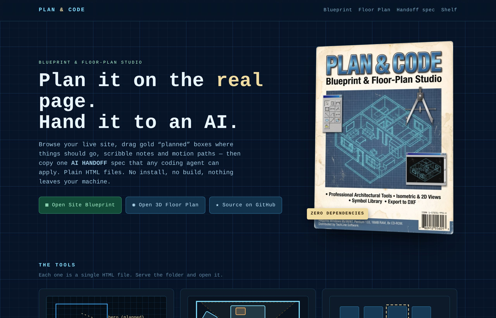

**Site Blueprint** — the hero is tracked, its gold planned box has been moved down, and notes are attached.

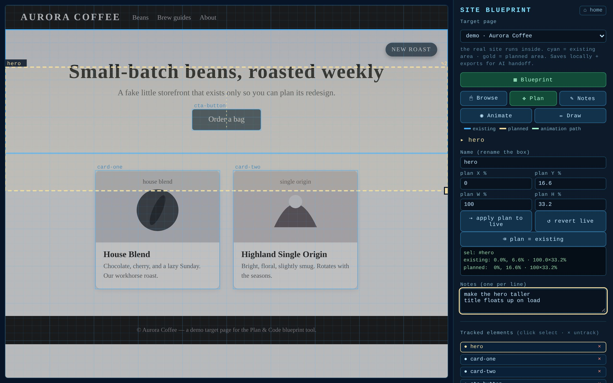

**Site Blueprint on the Software Shelf demo** (`?page=./demo/shelf.html`)

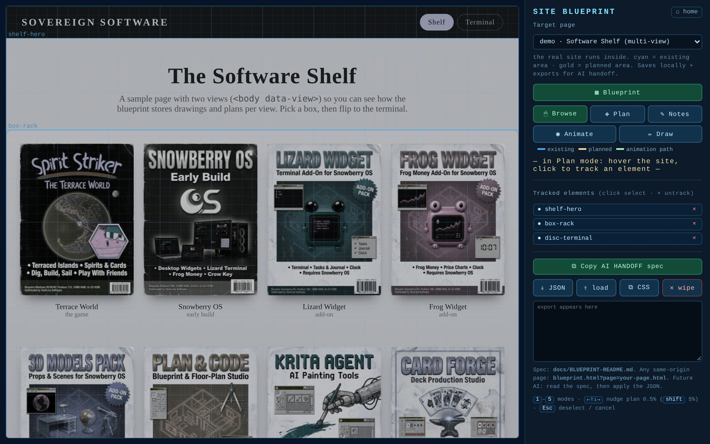

**3D Floor Plan** — the telescope is selected.

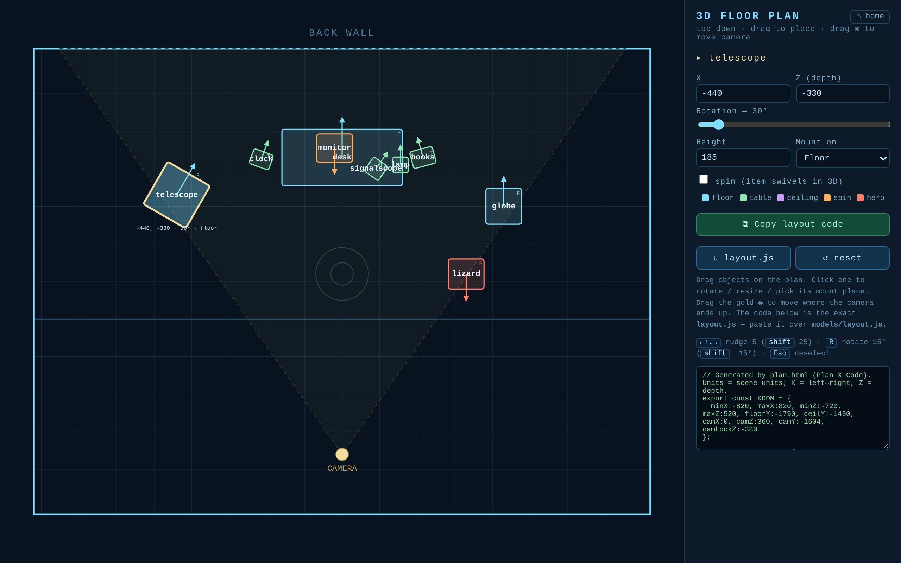

**On a phone** — the panel stacks under the stage.

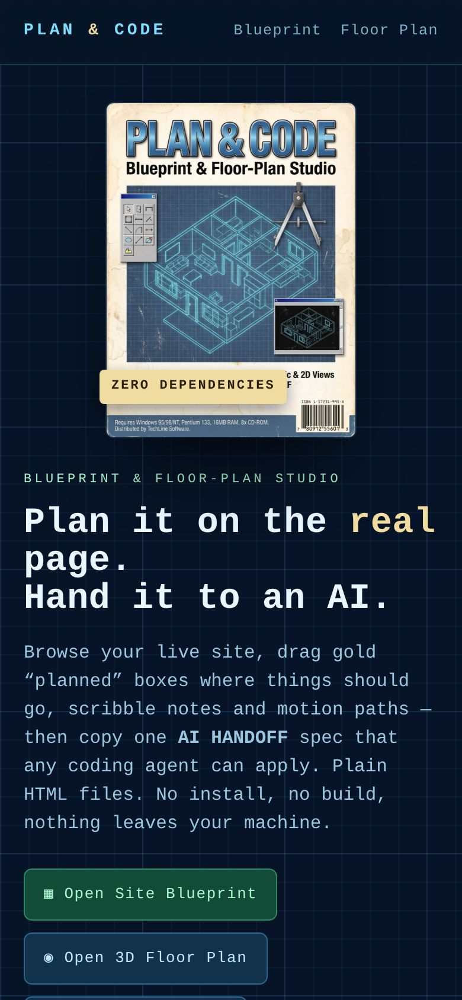 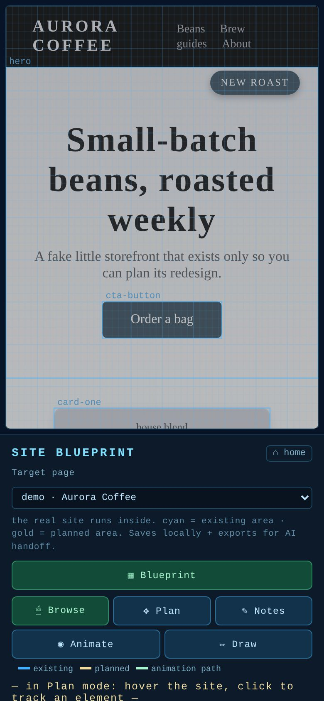 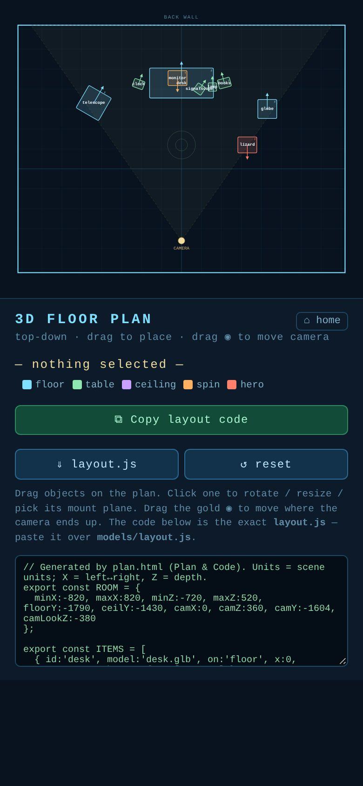

## Testing

The tools have no dependencies, but there is an optional end-to-end smoke test. It starts its own static server, loads every page in headless Chromium, and checks the main flows (seeding, keyboard nudge, label escaping, AI handoff export, JSON load, generated `layout.js` is a valid module):

```bash
npm i -D playwright && npx playwright install chromium   # once
node tests/smoke.cjs
```

## Notes

- Everything is client-side; no data leaves your machine (localStorage only).
- The `.glb` model files referenced in `models/layout.js` are sample data, not bundled — swap in your own scene's objects.
- Works in any modern browser (uses Pointer Events, Web Animations API, ES modules). Both tools work on phones and tablets too: the panel stacks under the stage below 760px.

## Publish

```bash
gh repo create Frog-dex/plan-and-code --public --source . --push
```

Because everything is static, the repo can also be served as-is with GitHub Pages (Settings → Pages → deploy from `main`, root). `index.html` is the landing page.

## The Sovereign Software shelf

Every box on the Spirit Strikers software shelf. Put the discs in the terminal here: https://frog-dex.github.io/terrace-world/library.html#software

| <a href="https://github.com/Frog-dex/terrace-world">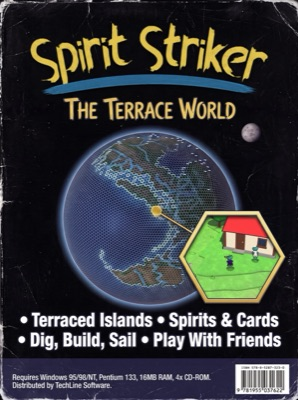</a> | 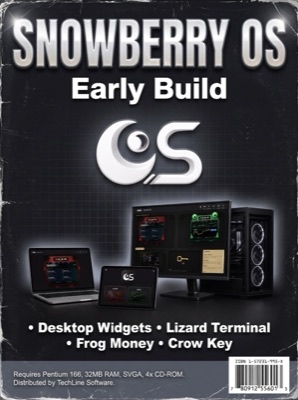 | 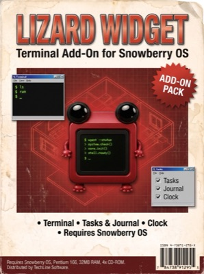 | 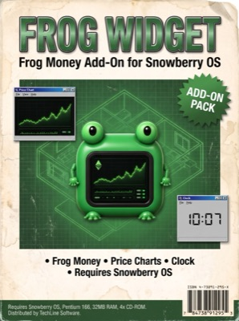 |
|:--:|:--:|:--:|:--:|
| **Terrace World**<br>the game | **Snowberry OS**<br>early build, not released yet | **Lizard Widget**<br>add-on, not released yet | **Frog Widget**<br>add-on, not released yet |

| <a href="https://github.com/Frog-dex/3d-models-pack">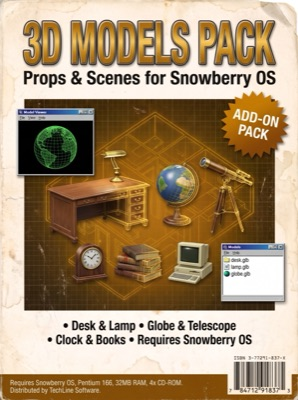</a> | <a href="https://github.com/Frog-dex/plan-and-code">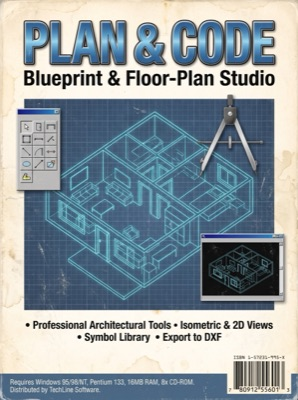</a> | <a href="https://github.com/Frog-dex/krita-agent">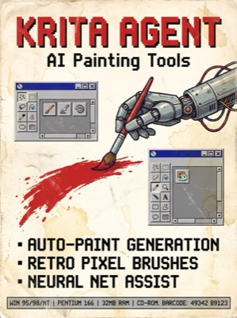</a> | <a href="https://github.com/Frog-dex/card-forge">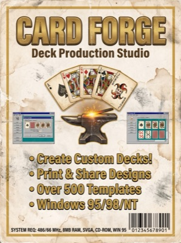</a> |
|:--:|:--:|:--:|:--:|
| **3D Models Pack**<br>thirteen free models | **Plan & Code**<br>plan a page, hand it to an AI | **Krita Agent**<br>AI tools inside Krita | **Card Forge**<br>card-making studio |

## License

MIT © 2026 Blu Inman
